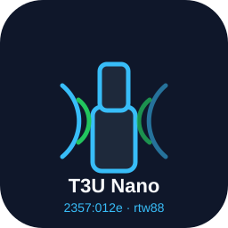

<p align="center">
  
</p>

<h1 align="center">TP-Link Archer T3U Nano (2357:012e) on OpenWrt<br>the rtw88 story — AP + STA tested</h1>

<p align="center">
  <a href="https://buymeacoffee.com/dr_gaussx"></a>
  
  
</p>

<p align="center"><i>🇮🇹 Versione italiana: <a href="README.it.md">README.it.md</a></i></p>

## TL;DR

The USB dongle with ID **`2357:012e`** is a **TP-Link Archer T3U Nano** (AC1300, chipset **Realtek RTL8812BU**). On OpenWrt it works with the **mainline `rtw88` driver** — **no out-of-tree driver needed**:

```sh
opkg update
opkg install kmod-rtw88-8822bu
```

Plug it in, create the interface (UCI/LuCI — examples below) and it works in **both AP and STA (client) mode**. Verified on OpenWrt 24.10.8, kernel 6.6.144, ramips/mt7621 (Xiaomi Mi Router 3G). Measurements below.

> ❗ The `rtl8812au-ct` / `rtl8821au` driver packages in this repo are **legacy**: built during the investigation on a wrong initial assumption. **Do not use them for `2357:012e`** — use mainline `rtw88`. They are kept for history, and the prebuilt `.ipk`s in [Releases](../../releases) are marked **deprecated**.

## The device

| | |
|---|---|
| USB ID | `2357:012e` (vendor TP-Link) |
| Device | **Archer T3U Nano** v1.x (AC1300, dual-band) |
| Chipset | **Realtek RTL8812BU** (RTL8822BU family), 2×2 802.11ac, USB 2.0 |
| Correct Linux driver | **mainline `rtw88`** → OpenWrt package **`kmod-rtw88-8822bu`** (pulls `rtw88_usb` + `rtw88_8822b` + `rtw88_core`) |
| Tested on | OpenWrt 24.10.8, kernel 6.6.144, ramips/mt7621, USB 2.0 port |
| Interface naming | `phyN-ap0` (AP), `phyN-sta0` (STA) — created by mac80211 |
| LED | not driven by `rtw88` on kernel 6.6 — **stays off**, cosmetic (see notes) |

Check yours is the same: `lsusb` → `ID 2357:012e TP-Link Archer T3U Nano`, or `cat /sys/kernel/debug/usb/devices`. The ID is confirmed in the linux-hardware.org database as handled by `rtw8822bu.c`.

## Install & configure

### 1. Packages

```sh
opkg update
opkg install kmod-rtw88-8822bu
```

The module auto-loads and creates a new `phy` (check with `ls /sys/class/ieee80211/`). For AP mode you also need `hostapd`/`wpad` (virtually every OpenWrt router image already has it).

### 2. AP mode (5 GHz VHT80 example)

Easiest way to create the radio: LuCI → *Network → Wireless → Add* (it auto-detects the USB radio). Equivalent UCI from our router:

```uci
config wifi-device 'radio2'
	option type 'mac80211'
	option path 'platform/1e1c0000.xhci/usb1/1-1/1-1:1.0'   # USB path: adapt to your board (see note)
	option band '5g'
	option channel '36'
	option htmode 'VHT80'
	option country 'IT'
	option disabled '0'

config wifi-iface 'default_radio2'
	option device 'radio2'
	option network 'lan'          # ← bridge into LAN: DHCP + firewall "just work"
	option mode 'ap'
	option ssid 'T2U-Nano-Test'
	option encryption 'psk2'
	option key 'testtest1234'
```

Apply with `uci commit wireless && wifi up radio2` (or `wifi reload`).

> **The USB `path` is machine-specific.** If you don't know it, add the radio from LuCI, or run `wifi config`/copy it from `ubus call network.wireless status`. Using the wrong path = radio stays down.

### 3. STA mode (client of another AP)

```uci
config wifi-iface 'default_radio2'
	option device 'radio2'
	option network 'wwan'
	option mode 'sta'
	option ssid 'YourSSID'
	option encryption 'psk2'
	option key 'YourKey'
```

```uci
config interface 'wwan'
	option proto 'dhcp'
	option defaultroute '0'       # keep 0 unless you *want* this link to take over the default route
	option peerdns '0'
```

Plus a firewall rule (fw4) so the DHCP replies to the client interface are not dropped (see gotcha below):

```uci
config rule
	option name 'Allow-WWAN-DHCP'
	option device 'phy3-sta0'     # adapt: name of YOUR sta interface
	option proto 'udp'
	option dest_port '68'
	option family 'ipv4'
	option target 'ACCEPT'
```

Then `uci commit && wifi up radio2 && ifup wwan`. Verify: `iw dev phyN-sta0 link`, and the `udhcpc` lease in `logread`.

## Performance (measured, not estimated)

Setup: Xiaomi Mi Router 3G (ramips/mt7621, **USB 2.0**), OpenWrt 24.10.8, dongle as AP on 5 GHz VHT80 ch36 (IT), clients: Samsung Z Flip 6 (2×2) and a PC (2×2).

| Test | Result |
|---|---|
| PHY rate client ↔ AP | **866 Mbps** (VHT80, MCS9, 2SS — both clients; phone: TX 866 / RX 585) |
| Latency, same subnet over Wi-Fi | **1–2 ms**, 0% loss |
| Throughput — AP → client (`curl` 64 MB from router) | **~156 Mbps** |
| Throughput — client → AP (upload to router) | **~57–59 Mbps** |
| Control: same tools over Ethernet | 578 Mbps (tooling validated; the ~59 Mbps is the real AP-RX limit of the dongle on this host) |
| STA mode — associate + DHCP + ping to hotspot gateway | OK (5–7 ms to the phone; 38–52 ms to 8.8.8.8 through the phone's uplink) |
| 2.4 GHz AP (ch1, 20 MHz) | ~40 Mbps (ch6 next to us was congested: ~20 Mbps) |

Notes: 64 MB `curl` transfers, source-bound (`--interface`), single client. With USB 2.0 on mt7621 don't expect hundreds of Mbps — the numbers above are what the hardware actually does here.

## Notes, quirks & the big firewall gotcha

**The gotcha that cost us days:** an AP interface **not assigned to any firewall zone** gets its input dropped by **fw4** (`input policy drop`) — clients can't even get DHCP, and it looks *exactly* like a broken driver/AP (we went down a whole driver-debugging rabbit hole because of this). Fix: put the AP in `network 'lan'` (bridge) as shown above. If you isolate it in a separate zone, remember DHCP/ICMP input rules. Same for STA mode: the DHCP replies knocking on `phyN-sta0` need an input ACCEPT (rule provided above).

- **USB probe quirk:** on first plug, `rtw_8822bu` may log `failed to register 0xc4` and the device re-enumerates itself; second probe succeeds and everything works. Cosmetic.
- **Harmless dmesg chatter:** `error beacon valid` / `failed to download drv rsvd page` can appear while reconfiguring the AP (channel/band changes) — observed with no functional impact.
- **LED:** the dongle's LED is controlled by chip registers, and mainline `rtw88` only gained LED support in **Linux 6.14** (upstream *"wifi: rtw88: Add support for LED blinking"*, commit `4b6652bc6d8d`; carried by newer OpenWrt mac80211 as `062-v6.14-wifi-rtw88-Add-support-for-LED-blinking.patch`). On OpenWrt 24.10 (kernel 6.6) the **LED stays off — this is expected and cosmetic**. On Windows/with vendor drivers it blinks. `ls /sys/class/leds` on 24.10 shows no `rtw88-*` entry (verified).
- **Country/regdomain:** set `country` correctly (we used `IT`). Ch36–48 on 5 GHz = no DFS hassle. On 2.4 GHz prefer the least crowded of 1/6/11.
- **Naming:** interfaces are `phyN-ap0` / `phyN-sta0` (mac80211 dynamic names), NOT `wlanX` — don't be surprised.

## Why is this repo called `...t2u-nano`? (history — what we discovered)

1. The dongle enumerates as `2357:012e` but **no in-tree driver claimed it** (`Driver=(none)`), so nothing was created — apparently "unsupported".
2. We assumed it was *yet another T2U Nano revision*: TP-Link already shipped `2357:011e` / `2357:0122` T2U Nano with RTL8811AU silicon, so a new PID looked like a new revision of the same product → we **force-added the ID to vendor drivers for the WRONG chip family** (`driver_info = RTL8821`): Candela's `rtl8812au-ct` (commits in this repo) and morrownr's `rtl8821au`. This was the mistake.
3. Dead ends from that path: force-binding the *stock* driver to the ID via `new_id` **instantly rebooted the router** (wrong `driver_info` → panic — don't do it); the -ct patched build bound but AP was unreliable; the vendor 8821au build associated in STA but with absurd latency (~350 ms) — none of it was ever going to be right.
4. Re-checking the USB-ID databases (linux-hardware.org) revealed the truth: **`2357:012e` = Archer T3U Nano, chipset RTL8812BU** — and mainline `rtw88` (`rtw8822bu`) had supported it all along.
5. Installed `kmod-rtw88-8822bu` → STA and AP both tested working (evidence above). The last mystery (clients associating but no DHCP in AP mode) turned out to be the **fw4 zone issue**, not the driver.

The legacy packages stay in the tree for reference; their prebuilt `.ipk`s are published in [Releases](../../releases) marked **deprecated**.

## Build it yourself (legacy packages only)

**For `2357:012e` you don't need to build anything** — `kmod-rtw88-8822bu` comes from the official feed. The instructions below reproduce the *legacy* vendor-driver builds.

### With the OpenWrt SDK (the exact method used here)

```sh
# 1. Get the SDK matching your target & release (we used 24.10.8, ramips/mt7621)
wget https://downloads.openwrt.org/releases/24.10.8/targets/ramips/mt7621/openwrt-sdk-24.10.8-ramips-mt7621_*.tar.zst
tar --zstd -xf openwrt-sdk-*.tar.zst
cd openwrt-sdk-*/

# 2. Drop the package(s) into the tree
cp -r /path/to/this/repo/package/rtl8812au-ct package/
cp -r /path/to/this/repo/package/rtl8821au   package/

# 3. Build
make package/rtl8812au-ct/compile -j$(nproc) V=s
make package/rtl8821au/compile   -j$(nproc) V=s
```

The `.ipk`s end up in `bin/packages/mipsel_24kc/base/` (kernel modules also under `bin/targets/ramips/mt7621/packages/`). Host prerequisites on Debian/Ubuntu: `build-essential file gawk gettext libncurses-dev python3 rsync unzip wget zstd`.

### Why the Makefiles look "patched"

Both vendor drivers needed build fixes for Linux 6.6 + OpenWrt backports + newer GCC: `-Wno-error` downgrades (upstream code trips `-Werror`), a `Build/Prepare` that removes a conflicting `wireless.h`, relaxes `-Wframe-larger-than`, disables a broken API workaround branch, and (for rtl8821au) a **firmware-download window fix** (`patches/002-fwdl-window.patch`). All build-oriented fixes — none of this is needed for `rtw88`.

## Prebuilt binaries (legacy, deprecated) + MD5

See [Releases](../../releases). Built with the **OpenWrt 24.10.8 SDK, ramips/mt7621, kernel 6.6.144** only — kernel modules are kernel-locked: `opkg` will refuse to install them on any other kernel/hash (`6.6.144~f31f6f85…`).

| File | MD5 | What |
|---|---|---|
| `kmod-rtl8812au-ct_6.6.144.2022.10.26~9b2b203a-r3_mipsel_24kc.ipk` | `486656d19726ffcfed75c9f8ff938176` | Candela rtl8812au-ct + forced `012e` ID — legacy |
| `kmod-rtl8821au_6.6.144.5.12.5.2-r5_mipsel_24kc.ipk` | `f14239a83b8415319f349036d52d7cf9` | morrownr 8821AU/8811AU + `012e` ID + fwdl fix (r5, last vendor attempt) — legacy |

Install (matching kernel only): `opkg install ./kmod-....ipk`. **Both are deprecated: you almost certainly want `kmod-rtw88-8822bu` instead.**

## Credits

- [OpenWrt](https://openwrt.org/) and mainline **rtw88** (Realtek; USB support by Sascha Hauer et al.)
- [Ben Greear / Candela](https://github.com/greearb/rtl8812AU_8821AU_linux) — `rtl8812au-ct`
- [morrownr](https://github.com/morrownr/8821au-20210708) — `rtl8821au`
- linux-hardware.org USB-ID database (device identification)

## Disclaimer

No warranty of any kind — use at your own risk, may void warranty / brick things. Do **not** force-bind the stock driver to unknown USB IDs via `new_id`: on our test router that caused an instant reboot (wrong `driver_info` → panic).

<p align="center">
  <a href="https://buymeacoffee.com/dr_gaussx"></a>
</p>
